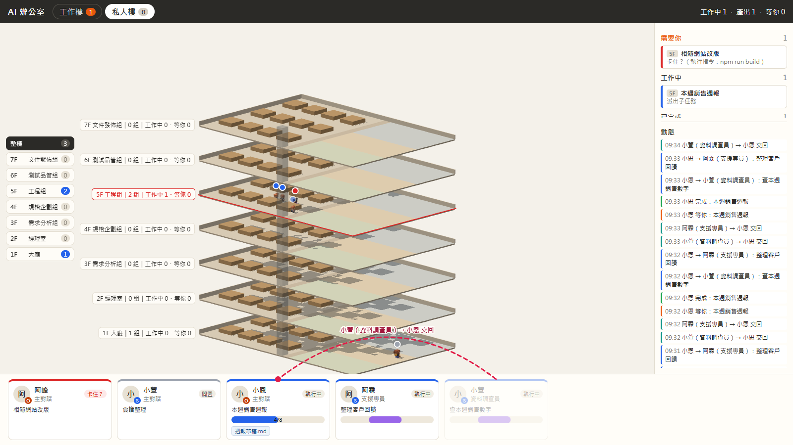
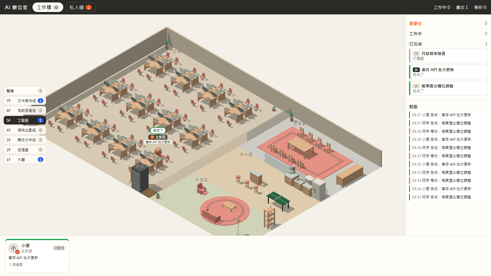
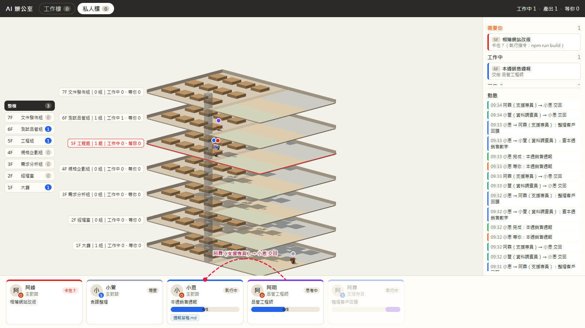
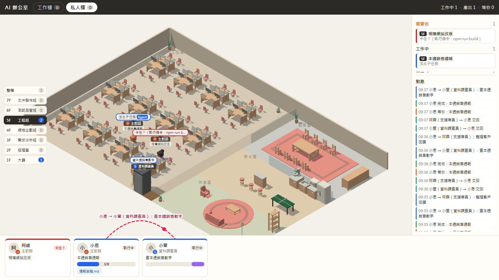
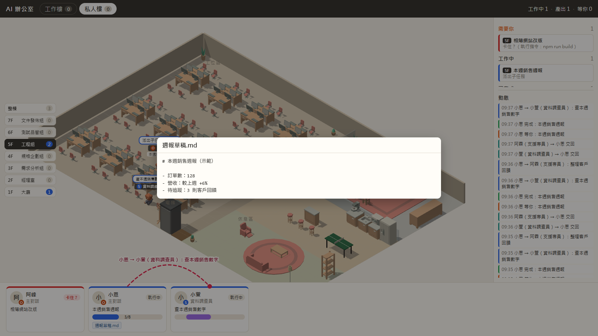
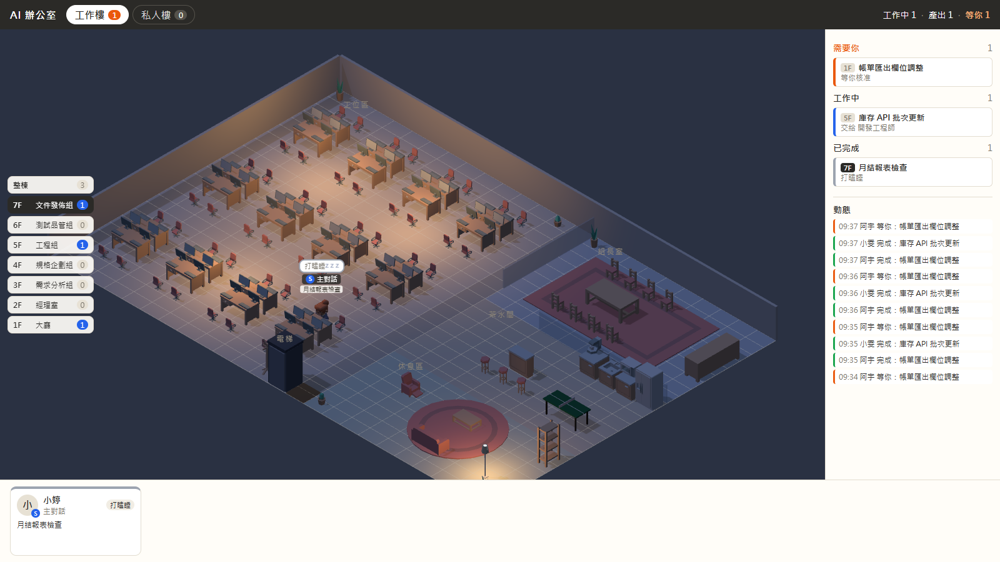

# AI 辦公室

把你電腦上所有 Claude Code 對話畫成一棟 **3D 等角辦公大樓**：一個對話一個小組，員工帶名字、職稱、模型標記與中文狀態泡泡。小組依目前使用的技能坐到對應的部門樓層（例如用 `/speclink-apply` 就在 5F 工程組），換技能時搭電梯換樓層。打開時先看到整棟的剖面，每層有誰、在做什麼、哪一層需要你一眼就看得到，想看細節再切進單一樓層。底部有員工卡片（進度條、產出檔），側欄有動態牆，派出子代理時卡片之間會畫交接弧線；沒事做的員工會晃去茶水間，久了打瞌睡，光線跟著白天黑夜變。

> **English summary** — AI Office turns every Claude Code conversation on your machine into a small team in a 3D isometric office: names, job titles, model badges and status bubbles (in Traditional Chinese), staff cards with progress bars and output files, an activity feed, and hand-off arcs when sub-agents are sent out. It only reads Claude Code's local transcripts, serves on `127.0.0.1` only, and uploads nothing. Requires Node.js 24. `npm install && npm run build && npm start`, then open <http://127.0.0.1:5188/>; `npm run demo` shows a scripted demo with made-up data. Each conversation sits on the floor of the department its current skill belongs to (built-in: five speclink departments on 3F–7F, everyone else in the 1F lobby) and rides the elevator when it switches skills. The page opens on a cutaway of the whole building; pick a floor to see it in detail. Buildings (e.g. a masked "work" building) and departments are configured in `~/.ai-office/config.json` — see `config.example.json`. Tested on Windows only.



- **只在本機**：伺服器只聽 `127.0.0.1`，不自動開瀏覽器，不寫 log 檔，不上傳任何東西。
- **只讀不寫**：只讀 `~/.claude/projects` 底下的對話紀錄，不寫入任何檔案。專案資料夾只有兩個例外，而且只限**沒有遮罩**的棟：讀正在處理的 speclink／spectra 變更的 `tasks.md` 算進度；你點產出標籤時，讀那個對話今天寫過的檔案來預覽。
- **遮罩的棟**：設定成遮罩的棟（例如公司專案），泡泡只顯示動作種類（「讀取檔案」「執行指令」），檔名、指令、子任務描述在伺服器端就去掉，不會送到瀏覽器；也不讀那些專案的任何檔案。

## 需求

- Node.js 24 以上（伺服器直接執行 TypeScript，不需要編譯伺服器）
- 已在 Windows 上測試；macOS／Linux 理論上可以執行，但沒有測試過

## 安裝與啟動

```bash
npm install
npm run build     # 產生前端畫面（web/dist），改過 web/ 底下的檔案才需要重跑
npm start         # 看你真正的 Claude Code 對話
```

主控台會印出網址，**自己用瀏覽器打開**：<http://127.0.0.1:5188/>。按 `Ctrl+C` 結束。沒有任何設定時，所有對話都在同一棟「辦公室」。

| 指令 | 用途 |
|---|---|
| `npm start` | 監看 `~/.claude/projects` 的對話紀錄 |
| `npm run demo` | 示範模式：六個虛構的小組照劇本動（含工作樓與私人樓、1F／5F／6F／7F、搭電梯、閒置、打瞌睡、進度、產出預覽），**完全不讀任何檔案**，也不看你的設定檔 |
| `npm run build` | 建置前端 |
| `npm test` | 自動測試（vitest） |
| `npm run typecheck` | 型別檢查 |
| `npm run check:public` | 個資掃描（見「參與開發」） |
| `npm run hook:install` | 預覽要加的「等你核准」Hook（加 `-- --yes` 才真的寫入） |
| `npm run hook:uninstall` | 預覽要移除的 Hook（加 `-- --yes` 才真的移除） |

連接埠被占用時會印出中文錯誤並結束；改用其他連接埠：

```powershell
$env:AI_OFFICE_PORT = 5190; npm start     # PowerShell
```

```bash
AI_OFFICE_PORT=5190 npm start             # macOS／Linux／Git Bash
```

## 畫面怎麼看

| 位置 | 內容 |
|---|---|
| 上方 | 棟分頁（只有一棟時不顯示；橘色數字＝那一棟有幾個對話在等你）、目前這一棟的「工作中 · 產出 · 等你」（整棟合計） |
| 左側 | 「整棟」與樓層按鈕（由高到低），每顆顯示樓層、部門名稱與人數；打開時預設是整棟，每一棟各自記得上次看的是整棟還是哪一層 |
| 中間 | 整棟時：所有樓層的剖面（見下方「整棟視圖」）。單層時：那一層的 3D 樓面，每層長得不一樣（見下方「每層長什麼樣」），門口旁都有電梯。滑鼠左鍵拖曳＝水平旋轉，滾輪＝縮放，右鍵拖曳＝平移 |
| 右側上半 | 整棟的小組依狀態分成「需要你／工作中／已完成」，每列前面標出所在樓層；點一列會切到那一層並把鏡頭移過去 |
| 右側下半 | 動態牆：整棟的「完成、交接、交回、等你」，新的在上，最多 30 則 |
| 底部 | 員工卡片列：整棟時列整棟所有員工，單層時只列那一層；點卡片鏡頭會移到那一組 |

### 整棟視圖

- 從側面看的大樓剖面：每層都放著那一層自己的擺設（和單層畫面一樣），所以 1F 大廳、2F 玻璃經理室、5F 機房一眼就分得出來；外面是玻璃外牆和轉角柱，屋頂招牌寫著棟名，電梯井貫穿各層。
- 1F 左邊有一張「1F 戰情看板」卡片，內容同 1F 後牆的大看板（每欄只列前 2 項）。
- 員工放大坐在自己樓層的工位上，頭上是狀態色點和狀態文字（例如「執行中」「等你」）；工具、檔名、指令只在單層畫面的泡泡裡看得到。
- 每層樓板前緣有該層主題色的色帶，右邊一張卡片寫著大字樓層號和「工程組｜2 組｜工作中 1・等你 1」。那一層有人「卡住？」時卡片和樓板邊框變紅，有人「等你」時變橘。
- 換技能的員工會走進電梯井、沿著井上下、到新樓層再走出來。
- 點某一層的樓板，或點左側的樓層按鈕，就進入那一層的單層畫面；點「整棟」回來。



### 樓層與部門

| 樓層 | 名稱 | 誰在這裡 |
|---|---|---|
| 1F | 大廳（總裁室＋自由座位區） | 沒有用過任何部門技能的對話 |
| 2F | 經理室 | （之後的派工功能使用） |
| 3F | 需求分析組 | 最近用的是 `speclink-discuss` |
| 4F | 規格企劃組 | `speclink-propose`、`speclink-ingest` |
| 5F | 工程組 | `speclink-apply` |
| 6F | 測試品管組 | `speclink-review`、`speclink-verify`、`speclink-audit`、`speclink-quality` |
| 7F | 文件發佈組 | `speclink-archive`、`speclink-commit` |

- 技能的來源有兩種：Claude 呼叫 Skill 工具，或你自己輸入斜線指令（例如 `/speclink-apply`）。spectra 同名技能也算。
- 小組坐在「最近用過、而且有對應部門的技能」那一層；用到沒有對應部門的技能（例如 `speclink-analyze`）不換樓層。
- 部門可以在設定檔的 `departments` 自己改（見「設定檔」）。

### 每層長什麼樣

| 樓層 | 地板 | 工作區 | 右側三個房間 | 桌上 |
|---|---|---|---|---|
| 1F 大廳 | 淺灰石材 | 自由座位 8 組；後牆一面**戰情大看板** | 總裁室（玻璃隔間）、接待區（接待櫃台）、等候區（沙發） | 筆電 |
| 2F 經理室 | 深木紋 | 6 間**玻璃獨立辦公室**，門牌「經理室 1～6」 | 主管會議室、茶水間（含桌球桌）、休息區 | — |
| 3F 需求分析組 | 暖黃地毯 | 後牆貼滿便利貼的白板 | 組長室（圓桌）、工作坊（立式白板）、訪談室（兩間小隔間） | 筆電 |
| 4F 規格企劃組 | 灰藍地毯 | 後牆看板（待辦／進行中／完成） | 組長室、規劃室（鋪藍圖的大桌）、資料室（書櫃） | 螢幕＋書 |
| 5F 工程組 | 深灰地毯 | 後牆監控螢幕牆 | 組長室、機房（伺服器機櫃）、休息區（懶骨頭、桌球桌） | 雙螢幕 |
| 6F 測試品管組 | 淺綠實驗室地板 | 後牆測試結果燈號看板 | 組長室、裝置實驗室（擺滿手機平板的測試長桌）、驗證區（紅綠燈柱、錯誤追蹤白板） | 螢幕＋手機 |
| 7F 文件發佈組 | 赤陶色地板 | 後牆「發佈倒數」看板 | 組長室、印製區（印表機、紙箱）、書庫 | 螢幕＋書 |

- **戰情大看板**（1F）：分三欄「待你決議」「卡住」「最新動態」，標題帶件數。前兩欄列出主對話在等你／卡住？的小組（例如「5F 相簿網站改版」），最新動態列出這一棟的動態並標上分類（完成／交辦／回報／等你），每欄最多 6 項。
- 自己加的部門用 `theme` 選五種部門樓面之一（`analysis`、`spec`、`build`、`qa`、`release`）；不填的話，代號剛好是這五個之一就用它，否則依部門順序輪流套用。



- **一組四個座位**：主對話坐第一個位子，子代理、技能員工坐旁邊；超過三位成員就站在走道。同一組的成員永遠在同一層。
- **進出**：1F 的員工從門口進出，其他樓層從電梯進出。
- **名牌**：泡泡（狀態）→ 職稱（前面的圓點是模型：O＝Opus、S＝Sonnet、H＝Haiku、F＝Fable）→ 小組名稱（主對話才有：優先用 Claude Code 自動產生的對話標題，還沒有標題時用第一句話，都截到 15 字）。
- **泡泡顏色**：紫＝思考中、藍＝執行中、青＝回覆中、綠＝已完成、橘＝等你、紅＝卡住？、灰＝閒置／打瞌睡。
- **卡住？**：執行中超過 10 分鐘、或思考中超過 8 分鐘沒有新動作。只是提醒，下一個動作出現就消失。
- 部門樓層最多 12 組入座、1F 大廳 8 組；超過的只出現在右側清單，標「未入座」。
- 對話 30 分鐘沒有新紀錄就整組離開；之後再有動作會回來，名稱不變。

### 員工卡片



- **名字**：每位員工從名單（內建 40 個兩字暱稱）依身分固定配一個，重開伺服器也不會換人。
- **目前任務**：主對話＝小組名稱；子代理＝派出時的任務描述（遮罩的棟顯示「處理子任務」）；技能員工＝技能職稱。
- **進度條**：
  - 沒有遮罩的棟裡的 speclink／spectra 對話：從技能參數、`--change` 指令或讀寫的 `openspec/changes/<名稱>/` 路徑判斷正在做哪個變更，讀它的 `tasks.md` 顯示「勾選數／總數」。
  - 算不出比例時，工作中的員工顯示來回流動的條；沒在工作就不顯示。
- **產出檔**：對話今天寫過或改過的檔案。沒有遮罩的棟顯示檔名（最多 3 個，其餘「+N」），點檔名跳出純文字預覽（最多 256KB、二進位檔不顯示內容，按 Esc 或點外面關閉）。遮罩的棟只顯示「N 個檔案」，沒有預覽。



### 交接弧線與動態牆

- 主對話派出子代理時，從主對話的卡片畫一條紅色虛線弧線到子代理的卡片，標籤如「小恩 → 小萱（資料調查員）：查本週銷售數字」；子代理交回時反方向。4 秒後淡出。
- 動態牆記「完成、交接、交回、等你」四種時刻。遮罩的棟的交接只寫「派出子任務」。

### 閒置、打瞌睡、日夜

- **閒置**（做完 3 分鐘）：員工離開座位，晃到那一層的休息點（例如 1F 的看板前和等候沙發、3F 的白板前、5F 的懶骨頭和桌球桌、7F 的書櫃）；一有新工作就走回座位。
- **打瞌睡**（再過 15 分鐘）：回座坐著，頭上「打瞌睡 z z z」。
- **日夜**：依電腦時間切換白天（07–17）、黃昏（17–19）、夜晚（19–07）。想直接看某個時段，在網址後面加 `?hour=21`（0～23）。



## 設定檔（選用）

位置：家目錄的 `.ai-office/config.json`（Windows 是 `%USERPROFILE%\.ai-office\config.json`）。**不建立也可以**。程式只讀這個檔、從不寫入；存檔後幾秒內就套用，不必重啟（`observe` 例外，要重啟）。格式寫錯時主控台印一行警告，整份退回內建預設。

最快的做法：把程式庫裡的 [`config.example.json`](config.example.json) 複製過去再改。它示範兩棟：`C:\Projects\work\` 底下的對話進「工作樓」並遮罩，其他都進「私人樓」。

| 鍵 | 意思 | 內建預設 |
|---|---|---|
| `buildings.rules` | 棟規則：`{ "prefix": 路徑, "building": 棟名, "mask": 是否遮罩 }`，最長的 prefix 優先，比對不分大小寫與斜線方向 | 沒有規則 |
| `buildings.default` | 都不符合時的棟 | `{ "building": "辦公室", "mask": false }` |
| `departments` | 部門樓層：`[{ "id": 代號, "name": 名稱, "floor": 3～99, "skills": [技能名稱, …], "theme": 樓面（選填） }]`，樓層號與代號不可重複，同一個技能只能屬於一個部門；`theme` 只能是 `analysis`、`spec`、`build`、`qa`、`release`；`[]` 表示只有 1F、2F | 3F～7F 五個 speclink 部門（見上方「樓層與部門」） |
| `roster.subagents`／`roster.skills` | 子代理類型、技能名稱對應的職稱 | 內建一份（例如 `Explore`＝資料調查員、`speclink-apply`＝開發工程師） |
| `roster.names` | 員工名字名單（至少 1 個） | 40 個兩字暱稱 |
| `buildingOverrides` | 某一棟的職稱覆寫，例如 `{ "工作樓": { "skills": { "speclink-apply": "後端工程師" } } }` | 沒有 |
| `groupLabelMaxChars` | 小組名稱最多幾個字 | 15 |
| `timing` | 卡住、閒置、打瞌睡、離開的時間（毫秒） | 見 `config.example.json` |
| `observe.sources` | 要觀察哪些 AI 工具的對話（見下一節） | `["claude-code"]` |
| `port` | 連接埠 | 5188 |

- 舊版設定檔的 `floors`（規則用 `floor` 欄位）與 `floorOverrides` 照樣可讀；新鍵 `buildings`、`buildingOverrides` 存在時以新鍵為準。
- 沒有用 speclink 的話，可以把 `departments` 改成你自己常用的技能，或設成 `[]`。
- 示範模式（`npm run demo`）永遠使用內建的兩棟示範設定與內建部門，不受這個檔影響；想看自己的設定效果請用 `npm start`。

## 觀察來源（接其他 AI 工具）

目前內建一種觀察來源：`claude-code`，讀 `~/.claude/projects` 的對話紀錄。設定檔的 `observe.sources` 決定要啟動哪些來源；寫了不認得的名稱，主控台會印一行警告並略過，其他來源照常運作；寫成空陣列 `[]` 就什麼都不觀察。

想接其他工具（例如 Codex CLI）：

1. 在 `server/src/observe/` 寫一個轉接器，實作 `ObserveSource`（`id`、`start()`、`stop()`），自己負責找紀錄檔、只讀新增的內容，並把每一行轉成 `OfficeEvent` 交給狀態庫（可以參考 `transcriptWatcher.ts` 與 `transcriptParser.ts`）。
2. 在 `server/src/observe/sources.ts` 的 `SOURCE_FACTORIES` 用一個新的 id 註冊它。
3. 使用者在設定檔寫 `"observe": { "sources": ["claude-code", "<新的 id>"] }`。

畫面完全不用改：所有來源都只產出 `OfficeEvent`，畫面只收加工後的 `OfficeView`。

## 「等你核准」Hook（選裝，只限 Claude Code）

不裝也看得到「等你回答」（Claude 問你問題、等你看計畫時）。裝了 Hook 之後，**權限確認**（要你按允許的時候）也會顯示「等你核准」。

```bash
npm run hook:install            # 先看會寫入什麼，不會改任何檔案
npm run hook:install -- --yes   # 確認後才寫入 ~/.claude/settings.json
npm run hook:uninstall -- --yes # 移除
```

- 寫入前會先備份成 `settings.json.ai-office.bak`；你原本的其他設定與 Hook 都保留。
- 只會加一筆 Notification Hook，用命令裡的 `ai-office-hook` 辨識；移除時也只移除這一筆。
- Hook 腳本 1 秒內一定結束、不輸出任何東西、永遠回報成功：辦公室沒開時對任何 Claude Code 對話都沒有影響。
- 只對安裝後**新開**的 Claude Code 對話生效。

## 程式結構

```
server/src/
  office/    事件契約 OfficeEvent、狀態庫、加工站（棟／樓層／職稱／中文／遮罩）、設定；levels.ts＝部門樓層
             feed.ts＝名字、動態牆、交接弧線；outputPreview.ts＝產出預覽
  observe/   觀察來源：sources.ts＝註冊表；transcriptWatcher.ts＝Claude Code 轉接器；
             changeProgress.ts＝tasks.md 進度
  http/      本機伺服器：靜態檔、/api/state、/api/output/<代號>、/events（SSE）、/hook
  demo/      示範劇本（虛構資料）
  main.ts    npm start / npm run demo 的進入點
web/src/
  scene/     Three.js 等角場景、七種樓面（floorPlans.ts）、程式方塊設備（props.ts）、戰情看板、A* 尋路、工位分配、閒置走動、日夜
  text.ts    畫面上所有固定文字（之後要加語言只換這裡）
  levels.ts  選樓層、樓層標籤、房間名稱
  ui.ts      棟分頁、樓層按鈕、統計列、側欄
  cards.ts   底部員工卡片與產出預覽視窗
  arcs.ts    卡片之間的交接弧線
  feed.ts    動態牆
hook/        Notification Hook 腳本與安裝／移除
scripts/     check-public.mjs＝個資掃描
assets/kenney/  Kenney CC0 家具與迷你人物（附授權檔）
tests/       vitest 測試與固定紀錄
```

## 參與開發

- 送出變更前請跑 `npm test`、`npm run typecheck`、`npm run build`。
- `npm run check:public` 會掃描所有會被提交的文字檔：出現電子郵件地址（GitHub noreply 與 example.com 除外）就失敗。你也可以在家目錄建立 `.ai-office/public-blocklist.txt`，一行一個你不想出現在程式庫裡的字串（例如自己的資料夾名稱），掃描會一併檢查；這個檔案只放在你的電腦上，不要放進程式庫。`npm test` 也包含這項檢查。
- 這是個人專案，盡力維護；歡迎開 Issue 回報問題。

## 美術素材

**目前使用**：家具與人物全部來自 Kenney 的 Furniture Kit 與 Mini Characters（CC0）。Kenney 沒有的設備（電梯、桌球桌、白板、看板、螢幕牆、伺服器機櫃、玻璃隔間、接待櫃台、紅綠燈柱、印表機等）由程式用方塊組成（`web/src/scene/props.ts`）。

**授權規則**（想換或混用素材時）：

- 放進這個倉庫的模型、貼圖只能是 **CC0**，或 **CC-BY 並在這一節標出作者與出處**。
- 只能「用在作品裡、不能散布原始檔」的素材（例如 Mixamo 的人物與動作）**不放進倉庫**。
- 新素材放在 `assets/<來源>/`，附上授權檔。

**可以混用的免費來源**：

| 類型 | 來源 | 授權 | 適合拿來 |
|---|---|---|---|
| 3D 模型 | Kenney（kenney.nl） | CC0 | 家具包其餘約 100 個模型、City／Building／Prototype 等套件 |
| 3D 模型 | KayKit（kaylousberg.itch.io） | CC0 | 家具、帶動作的角色、城市建築，風格和 Kenney 接近 |
| 3D 模型 | Quaternius（quaternius.com） | CC0 | 帶動作的角色、室內家具、模組化建築 |
| 3D 模型 | Poly Pizza（poly.pizza） | 每個模型不同（CC0 或 CC-BY） | 零星設備（白板、印表機、伺服器） |
| 3D 模型 | Sketchfab（可下載的模型） | 每個模型不同，多為 CC-BY | 選擇最多，風格要挑 |
| 3D 模型 | OpenGameArt、itch.io 免費區 | 每個素材不同 | 數量多，逐一看授權 |
| 環境光／材質 | Poly Haven（polyhaven.com） | CC0 | HDRI 環境光、材質 |
| 材質 | ambientCG（ambientcg.com） | CC0 | 地板、地毯、木紋、石材貼圖 |
| 圖示 | Lucide、Tabler Icons、Phosphor、Heroicons | MIT／ISC | 介面線條圖示 |
| 圖示 | Material Symbols | Apache 2.0 | 數量最多的圖示集 |
| 圖示 | game-icons.net | CC BY 3.0（要標作者） | 遊戲風圖示 |
| 圖示 | Iconify（iconify.design） | 依各圖示集 | 一次搜尋上百套圖示 |
| 介面元件 | Kenney UI Pack | CC0 | 遊戲風按鈕、面板 |
| 字型 | Noto Sans TC（Google Fonts） | OFL | 繁體中文字型 |

## 授權

- 程式：[MIT](LICENSE)
- `assets/kenney/` 的模型來自 Kenney（www.kenney.nl）的 Furniture Kit 與 Mini Characters，授權為 CC0（見同資料夾的兩份授權檔）。
